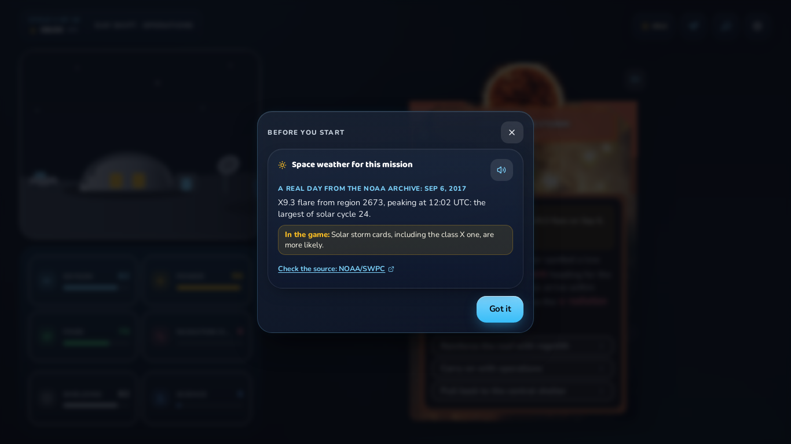
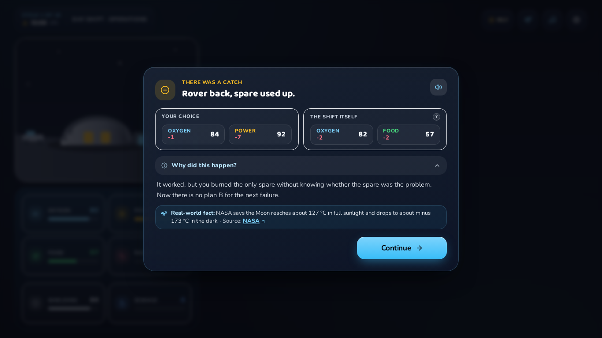

# Lunar Outpost

**A decision game where kids (ages 7–12) run a base on the Moon and feel the real trade-offs of a space
mission: air, power, food and radiation.** Built for the **NASA Space Apps Challenge 2026**, challenge
**"Build a Junior Astronaut Mission Trainer"**.

Every turn the player gets a card (a dust storm on the solar panels, a leaking airlock, a solar flare…)
and picks one of up to three options. No option is free: each one costs something, and the game then
explains, in one or two sentences, *why* that happened. The mission's space weather comes from **real
solar flares recorded by NASA and NOAA**, and it changes how likely solar storms are in that run.

- **Live demo:** `TODO(team)`, not published yet (see [Deploy](#deploy)).
- **Languages:** English (default) and Portuguese. Read-aloud for every card. Works offline as a PWA.


| The mission's real space weather (NOAA/NASA data) | Every outcome explains why, with a real-world fact and its source |
|---|---|
|  |  |

## How to play

1. **Plan the mission.** Pick the Moon (Mars is "coming soon"), one of 3 real landing sites
   (Mare Tranquillitatis, the Shackleton crater rim, the Marius Hills) and the goal NASA sent you for:
   **science** or a **stable life-support system**. Choose a commander; a structure and a piece of
   equipment are drawn at random (one reroll each). Each has a concrete effect on the run.
2. **Survive 10 cycles.** Each cycle has 2 day shifts (operations) and 2 night shifts (maintenance and
   watch). Shifts follow the base's UTC clock, not the Sun: at "night" the crew closes the hatches to
   sleep even if the Sun is shining outside. Twice a day two calls arrive at once and you can answer
   only one; on day 5 a supply capsule waits in orbit and you choose what lands first.
3. **Watch your resources (0–100).** The mission is lost if **oxygen**, **power** or **food** reaches 0,
   or if the crew's **radiation dose** reaches 100. Dose never goes down; **shielding** (regolith and
   water walls) does not get used up, it only *reduces* how much dose enters each day.
4. **Win** by surviving all 10 cycles, or earlier by bringing your declared goal (science or life
   support) to 100.

Wins unlock HUD themes, badges and a new commander. Outcomes you have seen are collected in the **Deck**.

## NASA data used, and why

| Dataset | How the game uses it | Live or stored? |
|---|---|---|
| **NASA DONKI** (CCMC, Moon to Mars Space Weather Analysis Office) — solar flares, `get/FLR` | When a mission starts, the game asks DONKI for the strongest flare of the previous 7 days. Its class (none, C, M or X) sets the mission's space weather, which changes the odds of the solar-storm cards. The "class X" storm card can only appear when the real flare was class X. The player sees the real event and its source in a panel at the start of the mission, in a chip on the game header, and on every solar-storm card. | **Live**, cached per day |
| **NOAA/SWPC daily event reports** (GOES X-ray flux) | 15 historical flare days (calm, C, M and X, including the X9.3 of 06/09/2017 and the X8.7 of 14/05/2024), each checked against the NOAA report of that day. Used when DONKI is unreachable or offline. | Stored in `src/content/spaceWeather.ts` |
| **NASA APOD, NASA EPIC (DSCOVR), NOAA GOES-19, NASA Image and Video Library** | The "look at space" window shows a real image of Earth or the sky, with its credit. | **Live**, with offline fallback |
| **NASA Image and Video Library** | Photos on the commander and structure cards (8 photos, each with its NASA ID). | Stored |
| **NASA and CSA references** (Moon facts, ECLSS, ISS water recovery, Orion radiation plan, RadLab/CRaTER, lunar impact monitoring, Apollo seismometers, LuSEE-Night, CSA food production) | The facts behind the card texts. 30 of the 43 cards show a "real-world fact" line after each decision, linking to one of 20 NASA or CSA pages; each fact was checked against the text of its page (`src/content/cardSources.ts`). | Text in the game |

**What is game design, not real data:** the 0–100 scales; the radiation dose (an abstract gauge, not
millisieverts); the weights that turn a flare class into storm odds (`src/engine/balance.ts`); the
resource costs of each option; and the landing-site profiles (the sites are real, their travel costs
and bonuses are written by hand). Some cards only appear where they make sense: polar ice cards only at
the Shackleton rim, the lava-tube card only at the Marius Hills and Mare Tranquillitatis.

All sources, with licenses, are in [`CREDITS.md`](CREDITS.md).

## Use of AI

The NASA Space Apps guide asks teams to declare AI ("SI") use. What we can state:

- **Idea and rules:** the game idea, rules and design choices came from the team. AI helped draft and
  organize the written specification (`docs/prompt.md`).
- **Code:** written with the AI assistant **Claude Code (Anthropic)** and the team. The git history shows
  it: commits authored by or co-authored with Claude (`Co-Authored-By: Claude …` trailers).
- **Card texts:** AI helped write the card descriptions, options and explanations; the team edited them,
  and every scientific claim was checked against the sources in `CREDITS.md`.
- **NASA data research:** AI helped research the NASA APIs and check the data (for example, comparing
  the 15 historical flare days with NOAA reports). Notes in `docs/RECURSOS_NASA.md`.
- **AI-generated media:**
  - the opening **cutscene images** (sky and Moon): marked on screen with "Images made with AI";
  - the **background music**: declared here, on the Credits screen, and in the MP3 metadata
    (`COMM` and `TXXX:AI_GENERATED=true`);
  - the **app icon**: declared here and in `docs/ASSETS.md`.
  - two **3D textures** (door and solar panel of the 3D base): their files carry Google C2PA metadata
    marking them as AI-generated; every 3D scene shows a "Some textures made with AI" badge.
  - The generation tools for the music and cutscene images: `TODO(team)`.
- **Not AI-generated** (per the team): the card frames (designed in Canva), the robot mascot, and the
  NASA photos.

The same summary appears on the in-game Credits screen. File-by-file details: [`docs/ASSETS.md`](docs/ASSETS.md).

## Run it locally

Requirements: Node.js 20+ and npm.

```bash
npm ci
npm run dev          # http://localhost:5173
npm test             # unit tests (Vitest)
npm run typecheck    # strict TypeScript, engine + app
npm run validate     # content invariants (every card has a free option, no option with only gains…)
npm run build        # production build in dist/
npm run sim 3000     # Monte Carlo balance check with 4 bot policies
```

With Docker (development server with hot reload, no local Node needed):

```bash
docker compose up    # http://localhost:5173
```

No API key is needed. Optionally, a free NASA key in `.env.local` (`VITE_NASA_API_KEY=...`, never
committed) raises the rate limit of the legacy APOD API.

## How it is built

- **React + TypeScript + Vite + Tailwind**, state in **Zustand**, installable **PWA** (vite-plugin-pwa).
- The lunar base is a **3D scene in three.js** (Blender models, loaded on demand in a separate chunk), with
  an "Explore the base" screen to orbit and zoom. Devices without WebGL, or with high contrast or reduced
  motion turned on, get the drawn SVG base instead.
- The game rules live in a **pure, deterministic engine** (`src/engine`): no React, no network, no clock,
  no `Math.random()`. The same seed always gives the same mission, so saves can't be "re-rolled" and bugs
  are reproducible. Space weather enters the engine as an input chosen when the mission starts.
- Content is data (`src/content/cards.ts` + `src/content/locales/{en,pt}.ts`), checked by tests:
  at most 3 options per card, at least one option without a requirement, no option with only gains.
- Balance is measured, not guessed: `npm run sim` plays thousands of missions with 4 bot policies. A
  random player wins about 1–2% of missions; careful players win about 90%. Decisions matter.

Project map: [`DESIGN.md`](DESIGN.md) (formal model). Internal docs in Portuguese are in
[`docs/`](docs/).

## Deploy

The build (`npm run build`) is a static site in `dist/`. Serve it from the **root** of an HTTPS domain
(for example Netlify, Vercel or Cloudflare Pages): the PWA uses `start_url: '/'`. A sub-path (like
`user.github.io/repo/`) needs `base` in `vite.config.ts` and matching `start_url`/`scope` in the
manifest. Do not put an API key in any `VITE_*` production variable (it would be public).

## Known limitations

- Only the Moon is playable; Mars, longer missions and harder difficulties are "coming soon".
- The radiation dose is a game gauge, not a calibrated dose; RadLab/CRaTER numbers are used as facts in
  text, not in the math.
- No Earth–Moon communication delay is simulated.
- Landing-site costs and bonuses are hand-tuned, not computed from terrain data.
- Limiting the polar-ice and lava-tube cards to their real sites left each site with one fewer science
  card, so reaching science 100 early is harder at some sites (winning by surviving is unchanged).
- Not yet play-tested with children.

## License

Original code: **MIT** (see [`LICENSE`](LICENSE)). Data, images, fonts and libraries keep their own
licenses ([`CREDITS.md`](CREDITS.md), [`docs/ASSETS.md`](docs/ASSETS.md)).

**NASA does not endorse any non-U.S. Government entity and is not responsible for information contained
on non-U.S. Government websites.** Lunar Outpost is an independent project; it is not an official NASA
product and is not endorsed by NASA.

## References

- Data and science sources: see the tables above and [`CREDITS.md`](CREDITS.md).
- Libraries: react, react-dom, zustand, zod, lucide-react (runtime); vite, @vitejs/plugin-react,
  vite-plugin-pwa (Workbox), tailwindcss, postcss, autoprefixer, typescript, vitest, jsdom, tsx (build
  and test). Versions and licenses in `CREDITS.md`.
- Fonts: Baloo 2 and Nunito (Google Fonts, SIL OFL 1.1). Icons: Lucide (ISC).
- Images and music: [`docs/ASSETS.md`](docs/ASSETS.md).
